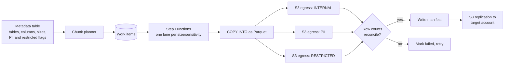

# lakefreight

[](https://github.com/sidbhaumik/lakefreight/actions/workflows/ci.yml)
[](pyproject.toml)
[](LICENSE)
[](https://github.com/astral-sh/ruff)

**Bulk-move warehouse tables into open lakehouse files on cloud storage, so any engine can read them.**

lakefreight unloads thousands of tables from a source warehouse into Parquet files on object storage, in a layout that Databricks, Snowflake, Redshift and BigQuery can all load or query. It plans the work from your metadata, keeps sensitive data in separate zones, and reconciles every extract before it is released.

It is built for the hard version of the job: thousands of tables, petabytes of data, many years of history, a fixed deadline, and a hand-off to storage owned by another cloud account in another region. The same method works for much smaller moves.

## Support matrix

| | Supported today | On the roadmap |
|---|---|---|
| **Source** | Snowflake | Other warehouses |
| **Target storage** | Amazon S3 | Google Cloud Storage, Azure Data Lake Storage |
| **File format** | Parquet, with a manifest and schema sidecar per table | Delta Lake and Apache Iceberg metadata over the same Parquet files |
| **Readers** | Any engine that reads Parquet: Databricks, Snowflake, Redshift, BigQuery | Native table registration in each |
| **Orchestration** | AWS Step Functions | |

**Status:** alpha. SQL generation, chunk planning, zone routing and reconciliation rules are unit tested. The Snowflake and AWS execution path (control-table DDL, Lambda handlers, state machine) has not yet been run against live services.

## What it does



- **Generates extract SQL from metadata.** One `COPY INTO` per table, or per date chunk for large tables. Nothing is hand-written.
- **Routes by sensitivity.** Three zones, each with its own stage, bucket location, key and role:
  - `RESTRICTED`: tables with tokenized identifiers, such as government ID numbers, that must leave in clear form
  - `PII`: tables with other personal data
  - `INTERNAL`: tables explicitly classified as non-sensitive

  Unknown classification is treated as sensitive.
- **Splits large tables into even chunks.** Months are packed to a target size, and the predicates cover every possible value, including NULL dates.
- **Detokenizes restricted columns** through a cross-reference table, with checks that the join neither drops nor duplicates rows.
- **Reconciles before release.** A manifest is written only when the unloaded row count equals the source count; the receiving side loads only what has a manifest.
- **Restarts at chunk level.** Every table or chunk is a tracked work item.

## Try it in two minutes

No Snowflake or AWS account needed. This generates extract SQL for five sample tables from a fictional travel company:

```bash
git clone https://github.com/sidbhaumik/lakefreight.git
```

```bash
cd lakefreight && python3 -m venv .venv && .venv/bin/pip install -e ".[dev]"
```

```bash
.venv/bin/lakefreight plan --metadata examples/metadata_sample.csv --profiles examples/profiles_sample.csv --out generated
```

Output:

```
5 tables -> 17 work items in generated/
  status: NEEDS_PROFILE 1, READY 16
  ready by zone: INTERNAL 1, PII 2, RESTRICTED 13
  note: TRAVEL.WEB.CLICK_EVENTS: chunk column EVENT_TS: confirm it prunes before using it
  note: TRAVEL.LEGACY.MISC_NOTES: table PII/RESTRICTED flag missing; treated as sensitive
```

Open `generated/RESTRICTED/TRAVEL.BOOKINGS.RESERVATION/0002_202203_202204.sql` to see an unload with the xref join and its two reconciliation queries.

Run the tests:

```bash
.venv/bin/python -m pytest -q
```

## Documentation

| Document | Read it when |
|---|---|
| [Migration guide](docs/migration-guide.md) | You have a migration like this to run and want the method, step by step |
| [Design decisions](docs/design-decisions.md) | You want to know why it is built this way, and what was rejected |

## Claude skill

The repo includes a [Claude Code skill](.claude/skills/generate-extract-sql/SKILL.md) that drives the generator. Open the repo in Claude Code and ask, for example, "generate extract SQL for the tables in my_metadata.csv". Claude normalizes the file, runs the generator, and reports which tables need a decision.

## Repository layout

| Path | Purpose |
|---|---|
| `src/lakefreight/cli.py` | The `lakefreight` command |
| `src/lakefreight/generate.py` | `lakefreight plan`: metadata CSV in, SQL files out |
| `src/lakefreight/chunk_planner.py` | Packs months into chunks with gap-free predicates |
| `src/lakefreight/renderer.py` | Renders the unload, source-count and unmatched-token SQL |
| `src/lakefreight/templates/copy_unload.sql.j2` | The `COPY INTO` template |
| `src/lakefreight/reconcile.py` | Pass/fail rules, manifest and schema sidecar |
| `src/lakefreight/planning.py` | Creates work items in Snowflake from the control tables |
| `src/lakefreight/handlers.py` | Lambda handlers: list, submit, poll, reconcile |
| `stepfunctions/extract_lane.asl.json` | State machine, one execution per lane |
| `sql/ddl/` | Control tables and the script that seeds them from metadata |
| `config/defaults.toml` | Thresholds, zones, lanes, xref names |
| `examples/` | Sample metadata and month profiles |
| `.claude/skills/` | The Claude skill |

## Not included

- Infrastructure as code: buckets, KMS keys, replication rules, stages, storage integrations, IAM, Lambda packaging.
- A single-pass `PARTITION BY` unload for large tables with no date column.
- Replication tracking, egress purge, and the delta pass for tables that change during the migration.

## Contributing

See [CONTRIBUTING.md](CONTRIBUTING.md). Changes are listed in [CHANGELOG.md](CHANGELOG.md).

## License

[MIT](LICENSE)
