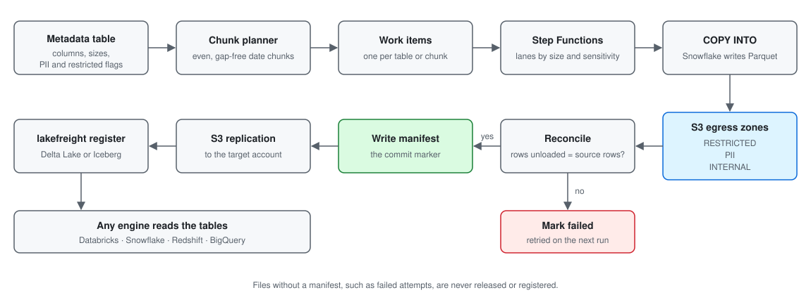

# lakefreight

[](https://github.com/sidbhaumik/lakefreight/actions/workflows/ci.yml)
[](https://pypi.org/project/lakefreight/)
[](https://github.com/sidbhaumik/lakefreight/blob/main/pyproject.toml)
[](https://github.com/sidbhaumik/lakefreight/blob/main/LICENSE)
[](https://github.com/astral-sh/ruff)

**Move Snowflake tables into open lakehouse files on S3, and prove that every row and value arrived intact.**

Moving a data warehouse out of Snowflake is easy to start and hard to trust. With thousands of tables, the questions that matter are: did every row arrive, are the values unchanged, did personal data stay where it belongs, and can any engine read the result?

lakefreight answers them. It plans the extract from your metadata, has Snowflake write Parquet straight to S3 in separate sensitivity zones, and checks every chunk before releasing it. Chunks that pass are registered as Delta Lake or Apache Iceberg tables that Databricks, Snowflake, Redshift and BigQuery can read.

```bash
pip install lakefreight
```



## Proven on live services

Each stage of the pipeline has been run against a real Snowflake account, a real AWS account and a Databricks workspace, not just unit tests. [Live validation](https://github.com/sidbhaumik/lakefreight/blob/main/docs/live-validation.md) records each run: what was tested, the numbers, and what it found.

| What was tested | Result |
|---|---|
| Full pipeline on AWS: 102 resources from Terraform, Snowflake writing to S3 through Step Functions and Lambda | All 18 work items reconciled; each zone's files encrypted with its own KMS key |
| Values, not just row counts, across 17 column types | Source and file fingerprints matched. Changing one email, swapping two names, or a bad unload with the right row count were all caught |
| A 2-million-row table extracted while a second session kept writing to it | Pinned to one snapshot, every chunk reconciled exactly. The unpinned control run failed, as expected |
| A 1-million-row table caught up to cut-over with three delta passes, while writes continued | The change sets applied to the bulk files matched Snowflake at the final snapshot exactly: 1,000,285 rows, none differing |
| A 10-million-row table with no date column, and a month holding 80% of a table | Every row fell in exactly one chunk, and every chunk query pruned partitions |
| Delta tables read in Databricks SQL, including time travel and file skipping | Identical row counts and values; a three-month filter read 3 of 12 files |
| A deliberate failure: 3 tokens missing from the cross-reference | The lane failed, the chunk got no manifest, and registration refused the table until a retry fixed it |

### What live testing caught

The offline tests passed in every case below. Running against real services found the problem, and each is now fixed and covered by a test. The write-up [Row counts are not proof](https://github.com/sidbhaumik/lakefreight/blob/main/docs/write-up.md) tells these stories in full.

- **A security gap between sensitivity zones.** Snowflake turns on all of a user's granted roles as secondary roles by default, so a session opened for non-sensitive data could also read the personal-data stages. Fixed in Terraform and in every connection ([0.5.1](https://github.com/sidbhaumik/lakefreight/blob/main/CHANGELOG.md#051---2026-11-26)).
- **Silent precision loss.** Snowflake's Parquet writer keeps only milliseconds, and moves pre-1970 timestamps *forward* in time. Row counts could not see this. Value fingerprints now catch it and fail the chunk by default.
- **A personal-data detector that matched almost nothing.** Snowflake's `REGEXP_LIKE` matches the whole string, while DuckDB, used in the tests, matches anywhere. A rule for `PASSPORT` missed `PASSPORT_NUMBER`.
- **A pipeline that reported success when every item failed.** The Step Functions run now fails with `LaneHadFailures`.

## How it works

1. **Discover.** `lakefreight discover` reads table sizes, columns, clustering keys and Snowflake's own sensitive-data classification. Columns nobody has classified are treated as sensitive.
2. **Plan.** Each table becomes one `COPY INTO`, or one per chunk for large tables, routed to the `RESTRICTED`, `PII` or `INTERNAL` zone. Each zone has its own stage, bucket, KMS key and Snowflake role, so a routing mistake causes a permission error, not a leak.
3. **Unload and reconcile.** Snowflake writes the Parquet; Python only coordinates, through Step Functions. A chunk gets a manifest only if its row count, its unmatched-token count and a fingerprint of every value all match the source.
4. **Register.** `lakefreight register` writes Delta Lake or Iceberg metadata over the files, without copying them, including only chunks with a manifest. `--update` replaces re-extracted chunks in one commit.
5. **Catch up.** For tables still being written, delta passes extract the rows changed since the last snapshot, as change sets that are checked like chunks, until cut-over.

## Where AI is used, and where it isn't

AI helps a person turn a messy metadata export into a reviewed plan. Everything that reads or moves data is ordinary data engineering: deterministic code, the same SQL from the same input every time, and no model called at run time.

| Step | What does it | AI |
|---|---|---|
| Find the tables, their sizes and sensitivity | `lakefreight discover`, reading Snowflake's metadata views and Snowflake's own sensitive-data classification | No. Classification is a Snowflake feature; lakefreight only reads its results |
| Turn your own export into lakefreight's metadata format | The [Claude Code skill](https://github.com/sidbhaumik/lakefreight/blob/main/.claude/skills/generate-extract-sql/SKILL.md) maps headers, converts units and writes a normalized copy | **Yes**, optional |
| Generate the extract SQL | `lakefreight plan`: templates and unit-tested rules for casting, zone routing, detokenization and chunking | No. The skill runs this command; it does not write SQL |
| Review the plan | The skill summarizes the generator's notes, such as unknown flags, chunk columns to confirm and profiles to run. You make each decision | **Yes**, optional, as a summary |
| Deploy the infrastructure | Terraform or OpenTofu | No |
| Create work items, unload to S3, reconcile | The planner, Step Functions and Lambda; Snowflake's `COPY INTO` writes the files | No |
| Transfer, register as Delta or Iceberg, delta passes, apply changes | S3 replication, `lakefreight register`, the planner, your target engine | No |

The skill sees metadata, never row values: table and column names, types, sizes, sensitivity flags, and the generator's output. It runs in Claude Code, under your permission settings and with your own environment. Without it, run `lakefreight plan` yourself and read `work_items.csv`: the SQL is identical. [Design decision 20](https://github.com/sidbhaumik/lakefreight/blob/main/docs/design-decisions.md#20-ai-prepares-the-inputs-deterministic-code-writes-the-sql-and-moves-the-data) explains why.

## Engineering highlights

Each of these has a written decision record in [design decisions](https://github.com/sidbhaumik/lakefreight/blob/main/docs/design-decisions.md), with the alternatives that were rejected.

- **Reconciliation that compares values.** A `HASH_AGG` fingerprint of the source, computed with the same expressions and joins as the unload, must equal the fingerprint of the files read back through the stage. It models Snowflake's timestamp truncation exactly, so the two sides agree bit for bit. ([16](https://github.com/sidbhaumik/lakefreight/blob/main/docs/design-decisions.md#16-reconciliation-compares-values-not-just-counts))
- **Consistent extracts from tables still being written.** Every query for a run, including retries, reads one Snowflake time-travel snapshot. The planner checks each table's retention first, and refuses tables that could expire mid-extract. ([17](https://github.com/sidbhaumik/lakefreight/blob/main/docs/design-decisions.md#17-tables-still-being-written-are-read-as-of-one-snapshot))
- **A delta pass that proves itself.** Snowflake change tracking yields the net changes between two snapshots. Each change set must match its source by count and fingerprint, and must balance: the rows at the first snapshot, plus inserts, minus deletes, equal the rows at the second. The planner checks change tracking and retention for every table before creating anything. ([18](https://github.com/sidbhaumik/lakefreight/blob/main/docs/design-decisions.md#18-the-delta-pass-reads-snowflakes-change-tracking-between-two-snapshots))
- **Sensitivity that fails closed.** Only an explicit "not sensitive" sends a table to the `INTERNAL` zone; a missing or unknown classification is treated as sensitive. Isolation is enforced by Snowflake and IAM privileges, not by the code taking the right branch. ([3](https://github.com/sidbhaumik/lakefreight/blob/main/docs/design-decisions.md#3-three-zones-enforced-by-privileges), [4](https://github.com/sidbhaumik/lakefreight/blob/main/docs/design-decisions.md#4-sensitivity-fails-closed))
- **A chunk planner with no gaps.** Ranges of a date or integer key are packed to a target size: whole months where they fit, days where they don't. Open-ended first and last ranges and a NULL chunk cover every possible value. The chunk column comes from the clustering key, so every chunk prunes. ([5–7](https://github.com/sidbhaumik/lakefreight/blob/main/docs/design-decisions.md#5-chunks-are-packed-to-a-size-not-fixed-to-a-calendar-period))
- **Open table formats without rewriting data.** Delta logs carry per-file column statistics from the Parquet footers so engines can skip files. Iceberg goes through pyiceberg. Registration refuses incomplete tables, schema drift and files still replicating. Updates of the same table can run in parallel: each commit is a conditional put, and a writer that loses re-plans from the winner's version. ([13](https://github.com/sidbhaumik/lakefreight/blob/main/docs/design-decisions.md#13-table-formats-are-registered-over-the-unloaded-files), [19](https://github.com/sidbhaumik/lakefreight/blob/main/docs/design-decisions.md#19-concurrent-updates-commit-with-a-conditional-put-and-retry))
- **Infrastructure for both clouds in one module.** Terraform creates the S3 buckets, KMS keys, IAM roles, Lambda functions and Step Functions on AWS, and the warehouses, roles, storage integrations, stages and key-pair service user on Snowflake. Its tests check the access policies with a mocked Snowflake. ([15](https://github.com/sidbhaumik/lakefreight/blob/main/docs/design-decisions.md#15-infrastructure-is-terraform-covering-both-aws-and-snowflake))

**Built with:** Python, Snowflake, AWS (S3, KMS, IAM, Lambda, Step Functions, Secrets Manager), Terraform/OpenTofu, Delta Lake (delta-rs), Apache Iceberg (pyiceberg), DuckDB, pytest, GitHub Actions, and PyPI trusted publishing.

## Try it in two minutes

No Snowflake or AWS account needed. This generates the extract SQL for five sample tables from a fictional travel company:

```bash
git clone https://github.com/sidbhaumik/lakefreight.git
```

```bash
cd lakefreight && python3 -m venv .venv && .venv/bin/pip install -e ".[dev]"
```

```bash
.venv/bin/lakefreight plan --metadata examples/metadata_sample.csv --profiles examples/profiles_sample.csv --out generated
```

```
5 tables -> 17 work items in generated/
  status: NEEDS_PROFILE 1, READY 16
  ready by zone: INTERNAL 1, PII 2, RESTRICTED 13
  note: TRAVEL.WEB.CLICK_EVENTS: chunk column EVENT_TS: confirm it prunes before using it
  note: TRAVEL.LEGACY.MISC_NOTES: table PII/RESTRICTED flag missing; treated as sensitive
```

The notes are the tool doing its job. A table with no sensitivity flag went to a protected zone, and a chunk column the tool can't confirm will prune is flagged for review. Open `generated/RESTRICTED/TRAVEL.BOOKINGS.RESERVATION/0002_202203_202204.sql` to see an unload with its detokenizing join and reconciliation queries.

Run the tests:

```bash
.venv/bin/python -m pytest -q
```

## Using it on your own Snowflake account

Install the extras you need: `snowflake` to read metadata, and `delta` or `iceberg` to register tables.

```bash
pip install "lakefreight[snowflake,delta]"
```

Write a settings file to edit:

```bash
lakefreight config --write
```

Discover your tables, using a connection from `~/.snowflake/connections.toml`. Add `--sql-only` to get the query and run it yourself instead:

```bash
lakefreight discover --database SALES --database HR --out metadata.csv
```

Plan the extract:

```bash
lakefreight plan --metadata metadata.csv --out generated
```

Unload with the generated SQL, or at scale with the Step Functions pipeline that [`infra/`](https://github.com/sidbhaumik/lakefreight/blob/main/infra/README.md) deploys. Then register each table once its chunks have landed:

```bash
lakefreight register --format delta --table-root s3://my-egress/internal/SALES/PUBLIC/ORDERS
```

The [migration guide](https://github.com/sidbhaumik/lakefreight/blob/main/docs/migration-guide.md) walks through a full migration, step by step.

## Scope and status

| | Supported | Not yet |
|---|---|---|
| **Source** | Snowflake | Other warehouses |
| **Storage** | Amazon S3 | Google Cloud Storage, Azure Data Lake Storage |
| **Table formats** | Delta Lake and Apache Iceberg, over the same Parquet files | |
| **Verified readers** | Databricks SQL (Delta), delta-rs, pyiceberg, DuckDB | Iceberg in Databricks; Snowflake, Redshift and BigQuery reads |
| **Orchestration** | AWS Step Functions, deployed with Terraform or OpenTofu | |

Version 1.1 covers the Snowflake-to-S3 path end to end, delta passes included, and every stage has run on live services except cross-account replication. It has not yet run a production-scale migration. From 1.0, the command line, settings, control tables, output layout and manifests are stable: every 1.x release keeps a migration in progress working. [Compatibility](https://github.com/sidbhaumik/lakefreight/blob/main/docs/compatibility.md) says exactly what is covered.

- **Out of scope by design:** continuous replication. lakefreight moves each table as of one point in time and catches up to cut-over; it is not a sync tool.
- **Platform limit:** Snowflake's Parquet unload keeps timestamps only to the millisecond. lakefreight detects the loss and fails the chunk, but cannot avoid it.
- **Next to build:** tracking of cross-account replication.

[Known gaps](https://github.com/sidbhaumik/lakefreight/blob/main/docs/design-decisions.md#known-gaps) has the full list, in those groups, and says what has been built but not yet run on live services.

## Documentation

| Document | Read it when |
|---|---|
| [Row counts are not proof](https://github.com/sidbhaumik/lakefreight/blob/main/docs/write-up.md) | You want the story: six problems that only live testing found, and what each one taught |
| [Migration guide](https://github.com/sidbhaumik/lakefreight/blob/main/docs/migration-guide.md) | You have a migration to run and want the method, step by step |
| [Design decisions](https://github.com/sidbhaumik/lakefreight/blob/main/docs/design-decisions.md) | You want to know why it is built this way, and what was rejected |
| [Live validation](https://github.com/sidbhaumik/lakefreight/blob/main/docs/live-validation.md) | You want to see what was proven on real accounts, and what each run found |
| [Compatibility](https://github.com/sidbhaumik/lakefreight/blob/main/docs/compatibility.md) | You want to know what stays stable across 1.x releases, and how to upgrade mid-migration |
| [Infrastructure](https://github.com/sidbhaumik/lakefreight/blob/main/infra/README.md) | You want to deploy the pipeline with Terraform |
| [Changelog](https://github.com/sidbhaumik/lakefreight/blob/main/CHANGELOG.md) | You want to see what changed in each release |

To use the [Claude Code skill](https://github.com/sidbhaumik/lakefreight/blob/main/.claude/skills/generate-extract-sql/SKILL.md), open the repo in Claude Code and ask it to "generate extract SQL for the tables in my_metadata.csv". Claude cleans up the file, runs the generator, and reports which tables need a decision. See [where AI is used](#where-ai-is-used-and-where-it-isnt).

## Repository layout

| Path | Purpose |
|---|---|
| `src/lakefreight/` | The package: `discover`, `generate` (plan), `chunk_planner`, `renderer`, `reconcile`, `planning`, `handlers` (Lambda) and `register` |
| `infra/terraform/` | Terraform/OpenTofu for AWS and Snowflake, with its own tests |
| `stepfunctions/` | The state machine, one execution per lane |
| `sql/ddl/` | Control tables, and the script that seeds them from metadata |
| `examples/` | Sample metadata and table profiles |
| `tests/` | The test suite, with fake Snowflake connections that behave like the real connector |

## Contributing

See [CONTRIBUTING.md](https://github.com/sidbhaumik/lakefreight/blob/main/CONTRIBUTING.md). To report a vulnerability, see [SECURITY.md](https://github.com/sidbhaumik/lakefreight/blob/main/SECURITY.md).

## Author

Built by **Siddhartha Bhaumik** ([@sidbhaumik](https://github.com/sidbhaumik))

## License

[MIT](https://github.com/sidbhaumik/lakefreight/blob/main/LICENSE)
